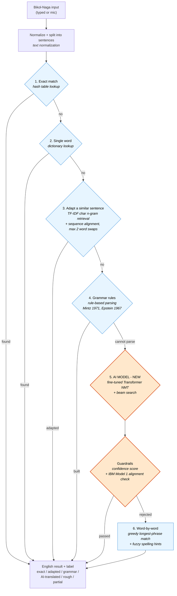
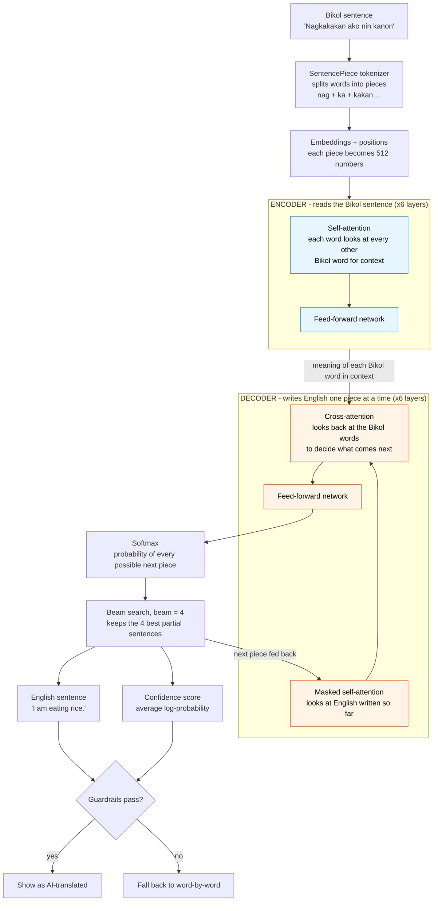
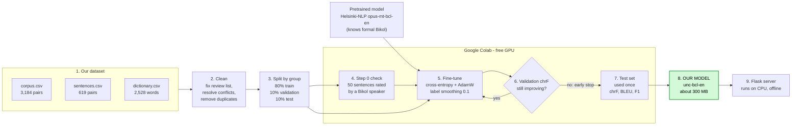
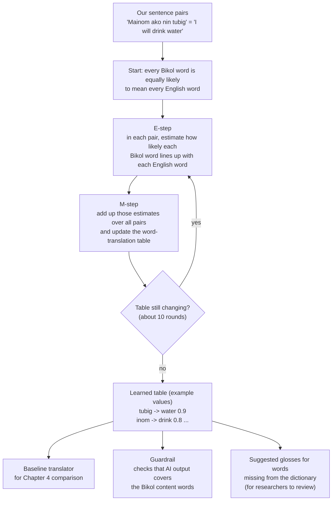
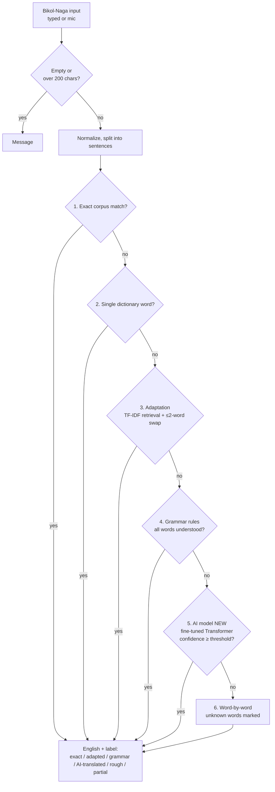

# AI Model Design — UNC Translator (Bikol-Naga → English)

**Status:** design only. Nothing in this document has been built yet.
**Purpose:** decide *what* AI model the team will build, *which algorithms* it uses and *why*, before writing any code — based on the dataset and code that already exist in this repository.

---

## 1. Summary (read this first)

| Question | Answer |
|---|---|
| What are we building? | A **neural machine translation (NMT) model** for Bikol-Naga → English, trained by the team on the team's own dataset, added as a new step inside the existing translation engine. |
| Which algorithm? | **Transformer encoder–decoder** (MarianMT architecture), trained with **transfer learning (fine-tuning)** from an existing Central Bikol→English model, decoded with **beam search**. |
| Is it "our own" model? | Yes. The fine-tuned weights are a new model, produced by the team's training run on the team's data. The starting point is cited, the same way the grammar rules cite Mintz (1971). |
| Why not train from zero? | ~6,300 sentence/word pairs is far too little for a neural model trained from nothing (Ranathunga et al. [9 in manuscript]). We still train one from scratch **as an experiment**, to show the panel the difference. |
| Supporting algorithms | **IBM Model 1** word alignment (EM algorithm, trained from scratch — fully ours), **TF-IDF character n-gram retrieval** for finding similar sentences, **confidence scoring** for guardrails. |
| Where does it run? | Trained on **Google Colab (free GPU)**. Runs **offline on the Flask server's CPU** — no internet, no paid AI API. |
| First step | A **go/no-go test** of the pretrained model on 50 of our sentences, rated by a Bikol-Naga speaker (Section 5). |

---

## Diagrams (for presentations)

> These are Mermaid diagrams. GitHub shows them as pictures automatically. In VS Code, install the **"Markdown Preview Mermaid Support"** extension and open the Markdown preview. To get an image for slides, paste a diagram into https://mermaid.live and export PNG/SVG.
>
> **Editable version:** [`AI_MODEL_DIAGRAMS.drawio`](AI_MODEL_DIAGRAMS.drawio) has the same four diagrams as separate pages. Open it at https://app.diagrams.net (File → Open from → Device) or with the VS Code "Draw.io Integration" extension.

### Diagram A — Which algorithm is used where

How one Bikol-Naga input is translated. Each box names the algorithm used at that step. Steps 1–4 and 6 already exist; **step 5 is the new AI model**.

### Diagram B — The AI model (inside step 5)

The model is a **Transformer encoder–decoder** (MarianMT). Sizes are from the pretrained model's `config.json`: 6 encoder layers, 6 decoder layers, 512-number vectors, 8 attention heads, 58,455-piece vocabulary.

### Diagram C — How the AI model is made (training pipeline)

Training happens once on Google Colab. Only the finished model is copied to the server, which then works offline.

### Diagram D — IBM Model 1 (the algorithm we build from scratch)

Learns which Bikol word means which English word using only our sentence pairs, with the **Expectation–Maximization (EM)** algorithm. Used as our from-scratch baseline and as a guardrail check on the AI output.

---

## 2. What exists today

The current engine (`engine.py`, `grammar.py`) has **no trained model**. It is a lookup-first, rule-based hybrid. For each sentence (`_segment` in `engine.py`) it tries, in order:

1. **Exact match** — the whole sentence is in the corpus (dictionary/hash lookup).
2. **Single dictionary word.**
3. **Example-based adaptation** — `adapt()`: a stored sentence of the same length that differs by ≤ 2 words; the stored English is reused with the changed words swapped. Uses `difflib.SequenceMatcher` alignment.
4. **Grammar rules** — `grammar.Grammar.translate`: hand-written rules (Mintz 1971, Epstein 1967). Builds a sentence only if every word is understood, else raises `NoParse`.
5. **Word-by-word** — `_rough()`: greedy longest-phrase match, unknown words kept and marked, fuzzy spelling hints (`get_close_matches`).

Measured on unseen sentences (manuscript Table 4.4, word-overlap F1):

| Step | Covers | Mean F1 |
|---|---|---|
| Adaptation | 19.0% of unseen sentences | 0.82 |
| Grammar | 9.2% more | 0.71 |
| **Only rough / partial / no output** | **71.9%** | — |

**That 71.9% is the gap the AI model is meant to close.** The exact, adaptation and grammar steps stay — they are reliable when they apply.

---

## 3. The dataset

| File | Rows | Use for the AI model |
|---|---|---|
| `data/corpus.csv` | 3,184 sentence/phrase pairs | Training / validation / test |
| `data/sentences.csv` | 619 sentence pairs | Training / validation / test |
| `data/dictionary.csv` | 2,528 word glosses (+ part of speech) | Training only (teaches vocabulary) |
| `data/review_needed.csv` | 532 rows not loaded | **Fix first** — each fixed row is more training data |
| `data/term_conflicts.csv` | conflicting glosses | Resolve before training (a model learns contradictions too) |

Total ≈ **6,300 pairs**. For comparison, general translation models are trained on millions of pairs.

**Quality issues that hurt a model more than they hurt the lookup engine:**
- Duplicate Bikol sentences with different English (305 rows in the review list) — the model learns to be inconsistent.
- Slash variants in the Bikol (`a/b`) — split into separate rows.
- English with explanatory notes in parentheses — already cleaned by `db.clean_english`; reuse it.
- Short phrases dominate (`Sa agap` → `Tomorrow`). Fine for vocabulary, but the model also needs full sentences.

**Rule:** data cleaning is the single biggest accuracy gain available. Budget time for it before training.

---

## 4. Options considered

Scored on the manuscript's four selection criteria (Ch. 3, Technique Selection).

| Option | Fit with ~6k pairs | Expected accuracy | Response time (CPU) | Feasibility | Verdict |
|---|---|---|---|---|---|
| A. Train a Transformer **from scratch** on our data | Poor | Low; fluent-looking but wrong output (hallucination) | Fast (small model) | Medium | **Experiment only** — shows why B is needed |
| B. **Fine-tune** a pretrained Central Bikol→English model | Good | Best available | ~0.3–1 s per sentence (to be measured) | High (Colab + Hugging Face) | **Selected (main model)**, if Step 0 passes |
| C. Statistical MT (IBM Model 1 word alignment, from scratch) | Good | Word-level only, no fluent sentences | Very fast | High, pure Python | **Selected (support + baseline)** |
| D. Large language model API (ChatGPT, Gemini) | n/a | Unknown for Bikol-Naga | Network-dependent | Breaks the offline requirement; costs money; not our model | **Rejected** |
| E. Multilingual model NLLB-200 (Meta) | — | — | — | Does **not** include Bikol | **Rejected** |

---

## 5. The pretrained model and the Step 0 check

**Model:** [`Helsinki-NLP/opus-mt-bcl-en`](https://huggingface.co/Helsinki-NLP/opus-mt-bcl-en) (University of Helsinki, OPUS-MT project).

| Fact (from the model card) | Value |
|---|---|
| Direction | `bcl` (Central Bikol) → `en` (English) |
| Architecture | Transformer (`transformer-align`, MarianMT) |
| Tokenizer | SentencePiece |
| Training data | "opus" — public parallel texts |
| Official test set | **JW300** (Jehovah's Witness publications) |
| Reported score | BLEU 56.1, chrF 0.697 **on JW300** |
| Size | `pytorch_model.bin` 299 MB |
| License | Apache-2.0 (free to use, modify, and publish results) |

**Is it "real Bikol from Camarines Sur"?** The language is right: Central Bikol is the Bikol of Camarines Sur, and the Naga variety is its standard form. The **register** is the risk: its test set is JW300, which strongly suggests most of its training text is formal religious writing, not campus conversation. Its 56.1 BLEU is measured on that same kind of text and **will not carry over** to our sentences.

**Step 0 — go/no-go (1–2 days, before any other AI work).** Notebook: [`ai/step0_pretrained_check.ipynb`](../ai/step0_pretrained_check.ipynb) (run on Google Colab).
1. Pick 50 sentences from our dataset: 25 casual/campus, 25 simple/formal.
2. Run the pretrained model on them in Colab, unchanged.
3. A Bikol-Naga speaker on the team rates each output: correct / acceptable / incorrect.
4. Compute chrF against our English.

**Decision rule:**
- If at least the simple sentences are mostly acceptable → the model understands Bikol; fine-tune it (Option B is the main model).
- If it fails even on simple sentences → drop it; Option A/C become the main model and the document's expectations are lowered accordingly.

Record the 50 sentences, outputs, and ratings — they become a table in Chapter 4.

---

## 6. Architecture

**Why the AI step is placed after grammar (initial order):** the grammar module is high-precision by design (it refuses when unsure) and every rule is cited. The AI model is placed after it at first. The final order is decided by measurement (Section 10): if the AI model scores higher than grammar on sentences both can handle, the two steps are swapped. The manuscript already orders steps by measured quality, so this is consistent with it.

---

## 7. Algorithms explained (plain language, for the panel)

### 7.1 Transformer encoder–decoder (the main model)
- The **encoder** reads the whole Bikol sentence and turns each word piece into a vector (a list of numbers) that captures its meaning *in context*.
- The **decoder** writes the English one word piece at a time. At each step it uses **attention**: it looks back at all the Bikol vectors and decides which ones matter for the next English word. This is how it learns word order changes (Bikol verb-first → English subject-first) without hand-written rules.
- Source: Vaswani et al., 2017; Marian implementation: Junczys-Dowmunt et al., 2018.

### 7.2 Subword tokenization (SentencePiece)
- Words are split into frequent pieces: `nagkakakan` → `nag` + `ka` + `kakan`. The model can then handle verb forms it never saw whole, because it has seen the prefix and the root separately — this matters a lot for Bikol's affix-heavy verbs.
- We reuse the pretrained model's tokenizer unchanged (changing it would break fine-tuning).
- Source: Kudo & Richardson, 2018.

### 7.3 Fine-tuning (transfer learning)
- Start from the pretrained weights, continue training on our pairs with a small learning rate. The model keeps its general Bikol knowledge and adapts to our vocabulary and casual style.
- Training objective: **cross-entropy** — at each position, the model is penalized by how little probability it gave the correct next English word piece.
- Optimizer: **AdamW**; **label smoothing 0.1** (reduces over-confidence on a small dataset); **early stopping** when validation chrF stops improving (prevents memorizing the training set — the main danger with ~6k pairs).

### 7.4 Beam search (decoding)
- Instead of always picking the single most likely next word, keep the **4–5 best partial sentences** at each step and finish with the overall most likely one. Gives more fluent output than greedy decoding.
- Its final score also gives us the **confidence** (Section 7.7).

### 7.5 IBM Model 1 word alignment (trained from scratch — fully ours)
- Learns, from sentence pairs alone, the probability that Bikol word *b* translates to English word *e*, i.e. t(e | b).
- Algorithm: **Expectation–Maximization (EM)**. Start with all translations equally likely; repeatedly (E-step) guess which English word each Bikol word is aligned to in every sentence pair using current probabilities, then (M-step) re-count and update the probabilities. Converges in ~10 iterations.
- ~50 lines of pure Python, no dependencies, trains in seconds on CPU.
- Uses: (1) a from-scratch **baseline** for Chapter 4; (2) **suggested glosses** for Bikol words missing from `dictionary.csv`, given to the researchers to *review* (never shown to users as fact); (3) a **sanity check** on AI output (Section 7.7).
- Source: Brown et al., 1993.

### 7.6 TF-IDF character n-gram retrieval (upgrade to adaptation & suggestions)
- Represent every corpus sentence by its character 3–4-grams, weighted by **TF-IDF** (rare n-grams count more). Find the nearest stored sentence by **cosine similarity**.
- Replaces the `SequenceMatcher` scans in `adapt()` and `suggest()` for candidate search. Benefits: faster, and tolerant to spelling variants (`maduman` / `ma duman`, `dae` / `da'i`) that word-level matching misses.
- Can be written in pure Python (no scikit-learn needed at runtime), keeping the server's dependencies small.

### 7.7 Confidence and guardrails
The project principle is "translations come from the dataset or cited rules — do not invent glosses." An NMT model *can* invent. Guardrails:
1. **Confidence** = average log-probability of the output tokens from beam search. Below a threshold (tuned on the validation set) → discard, fall back to word-by-word.
2. **Sanity checks** → discard if: output much longer/shorter than expected (length ratio), repeated phrases (a known NMT failure), or IBM Model 1 finds most input content words unaligned to anything in the output.
3. **Labeling** — every AI result is shown as **"AI-translated — may contain errors"**, separate from "exact" (researchers' own English).
4. **Unknown words still marked** — Bikol words not in the dictionary are still highlighted in the AI result, so the user sees which parts are not backed by the dataset.

---

## 8. Data preparation

1. Load `corpus.csv` + `sentences.csv`; apply the same `normalize()` (`engine.py`) and `db.clean_english` used by the engine.
2. Remove exact duplicates; resolve conflicting duplicates with the researchers (or keep only the first, as the engine does).
3. **Group near-duplicates** (sentences that differ by one word) so a group never spans train and test — otherwise test scores are inflated by memorization.
4. **Split by group: 80% train / 10% validation / 10% test.** Fixed random seed; save the split as CSV files so every experiment uses the same split.
5. Add all `dictionary.csv` pairs to **train only**.
6. Optional augmentation (train only, marked as synthetic, never in test):
   - **Substitution** — reuse the `adapt()` idea in reverse: in a training sentence, swap one noun with another dictionary noun of the same category and swap the English gloss.
   - **Back-translation** — Helsinki-NLP also publishes `opus-mt-en-bcl` (English → Bikol). Translate English campus sentences into synthetic Bikol to create more pairs (Sennrich et al., 2016). Lower priority; only if Step 0 shows the models handle our register.

---

## 9. Training on Google Colab

Notebook `ai/train_colab.ipynb` (to be written):

| Setting | Starting value |
|---|---|
| Libraries | `transformers`, `datasets`, `sentencepiece`, `sacrebleu` |
| GPU | Colab free tier (T4) |
| Max length | 128 tokens |
| Learning rate | 3e-5 (try 2e-5 – 5e-5) |
| Batch size | 16–32 |
| Epochs | up to 20, **early stopping** (patience 3) on validation chrF |
| Label smoothing | 0.1 |
| Beam size | 4 |
| Seed | fixed (e.g. 42), recorded |
| Expected time | roughly 10–30 minutes per run (to be measured) |

Steps: upload the split CSVs → zero-shot evaluate (this is Step 0 on the full validation set) → fine-tune → evaluate on validation each epoch → keep best checkpoint → evaluate **once** on the test set → download the model folder.

From-scratch Transformer (experiment): same notebook, a small randomly initialized Marian model (e.g. 3 layers, 256 dimensions), same data and split.

**Rule:** the test set is used once, at the end. All tuning (learning rate, threshold, step order) uses the validation set only.

---

## 10. Evaluation

**Metrics**
- **chrF** (Popović, 2015) — character-level; fairer than BLEU for short sentences and for Bikol's affixes. Main automatic metric.
- **BLEU** via **sacreBLEU** (Post, 2018) — reported because readers expect it.
- **Word-overlap F1** — the metric already used in Table 4.4, for comparability with the current system.
- **Human rating** — correct / acceptable / incorrect by Bikol-Naga speakers, as already planned in Chapter 3. This remains the real measure of accuracy.
- **Response time** — CPU, 1 user and 10 concurrent users; requirement ≤ 3 s.

**Leakage rule:** when evaluating the full hybrid, test sentences must be **removed from the lookup database** (otherwise the exact-match step "answers" them). The current leave-one-out test already does this via `skip_key` in `adapt()`; extend the same idea.

**Result tables to fill (Chapter 4):**

| System | chrF | BLEU | F1 | % rated correct/acceptable | Avg / max time |
|---|---|---|---|---|---|
| Current engine (no AI) | | | | | |
| IBM Model 1 word-by-word (from scratch) | | | | | |
| Transformer from scratch | | | | | |
| opus-mt-bcl-en, not fine-tuned (Step 0) | | | | | |
| opus-mt-bcl-en, fine-tuned (**ours**) | | | | | |
| Full hybrid (engine + fine-tuned model) | | | | | |

Plus: share of test sentences that receive a complete sentence (currently 28.1%), and how many AI outputs the guardrails rejected.

---

## 11. Integration into this codebase (after the model passes evaluation)

| Change | Where |
|---|---|
| New folder `ai/`: `prepare_data.py` (split), `train_colab.ipynb`, `evaluate.py`, `ibm1.py`, `model.py` (load model once, `translate(text) → (english, confidence)`) | new |
| Trained model folder `models/unc-bcl-en/` (~300 MB) — **not committed to git**; distributed via a GitHub Release or Hugging Face | add `models/` to `.gitignore` |
| New step in `_segment()` between grammar and word-by-word; new `method: "ai"` and label | `engine.py` |
| If the model folder is missing, the system works exactly as today (AI step skipped) | `engine.py` |
| Optional: TF-IDF candidate search inside `adapt()` / `suggest()` | `engine.py` |
| Show the "AI-translated" label and message | `frontend_src/App.jsx` — **first bring the source up to date with the built `static/assets/app.js`** (see `CLAUDE.md`), then rebuild |
| Dependencies: `torch` (CPU build), `transformers`, `sentencepiece` (or `ctranslate2` for faster int8 CPU inference) | `requirements.txt` — the project is currently Flask-only; this is a real change in install size |
| Tests: AI step with a fake model (no 300 MB download in tests); fallback when the model is missing; low-confidence rejection | `tests/test_system.py` |

History, `frequency_of_use`, the result format (`kind`, `method`, `parts`, `message`) and all account/admin features stay unchanged.

---

## 12. Risks and mitigations

| Risk | Mitigation |
|---|---|
| Model invents a plausible but wrong translation (hallucination) | Confidence threshold, sanity checks, "AI-translated" label, unknown words still marked |
| Register mismatch: religious/formal OPUS Bikol vs. casual campus Bikol and Taglish code-switching | Step 0 check; fine-tuning on our data; collect more casual sentences from the planned survey |
| Overfitting on ~6k pairs | Early stopping, label smoothing, group-based split, evaluate test set once |
| Inflated scores from near-duplicates | Group near-duplicates before splitting; remove test sentences from the lookup DB |
| CPU too slow for 10 users | Measure; load model once at startup; CTranslate2 int8; cache repeated inputs |
| 300 MB model in a Flask-only project | Keep out of git; download step in README; system still runs without it |
| Conflict with FR 2.9 ("never guess the meaning of a word not in the dictionary") | Must be resolved in the manuscript — see Section 13 |

---

## 13. Manuscript changes this will require

- **FR 2.2** — add the AI step to the processing order.
- **FR 2.8** — add the "AI-translated" label.
- **FR 2.9** — currently forbids guessing words not in the dictionary. An NMT model may translate such words. Proposed wording: the system never presents a guessed meaning *as dataset content*; AI output is labeled and unknown words remain marked. **Discuss with the adviser.**
- **Ch. 3** — architecture (Fig. 3.4), lookup order (Fig. 3.9), sequence diagram (Fig. 3.15), Level 1 DFD (Fig. 3.7): add the AI model; add the training procedure and the data split.
- **Ch. 4** — Table 4.4: add rows for the new techniques; new results table (Section 10); Step 0 table.
- **Ch. 2** — add OPUS-MT / MarianMT and Transformer literature.
- Record every change in `CHANGES_TO_MANUSCRIPT.md` when the model is actually built.

---

## 14. Milestones

| # | Milestone | Output | Rough time |
|---|---|---|---|
| 0 | Step 0 go/no-go check | 50 rated outputs, decision | 1–2 days |
| 1 | Data cleaning (review list, conflicts) | Cleaned CSVs | 1–2 weeks |
| 2 | Fixed train/val/test split | `ai/prepare_data.py`, split CSVs | 1–2 days |
| 3 | IBM Model 1 baseline | `ai/ibm1.py`, baseline scores | 2–3 days |
| 4 | Fine-tune + from-scratch experiment on Colab | Trained model, validation scores | 1 week |
| 5 | Guardrail threshold tuning, step order decision | Threshold, final order | 2–3 days |
| 6 | Integration + tests | AI step in `engine.py`, UI label | 1 week |
| 7 | Final test-set evaluation + human rating + timing | Chapter 4 tables | 1–2 weeks |

---

## 15. References

- Brown, P. F., Della Pietra, S. A., Della Pietra, V. J., & Mercer, R. L. (1993). The mathematics of statistical machine translation: Parameter estimation. *Computational Linguistics, 19*(2).
- Vaswani, A., et al. (2017). Attention is all you need. *NeurIPS*.
- Junczys-Dowmunt, M., et al. (2018). Marian: Fast neural machine translation in C++. *ACL System Demonstrations*.
- Tiedemann, J., & Thottingal, S. (2020). OPUS-MT — Building open translation services for the world. *EAMT*.
- Helsinki-NLP. *opus-mt-bcl-en* model card. https://huggingface.co/Helsinki-NLP/opus-mt-bcl-en
- Agić, Ž., & Vulić, I. (2019). JW300: A wide-coverage parallel corpus for low-resource languages. *ACL*.
- Kudo, T., & Richardson, J. (2018). SentencePiece: A simple and language independent subword tokenizer and detokenizer. *EMNLP System Demonstrations*.
- Sennrich, R., Haddow, B., & Birch, A. (2016). Improving neural machine translation models with monolingual data. *ACL*.
- Popović, M. (2015). chrF: Character n-gram F-score for automatic MT evaluation. *WMT*.
- Post, M. (2018). A call for clarity in reporting BLEU scores. *WMT*.
- Ranathunga, S., et al. (2023). Neural machine translation for low-resource languages: A survey. *ACM Computing Surveys* (manuscript ref. [9]).
- Mintz, M. W. (1971). *Bikol Dictionary*; Epstein, J. (1967). *Standard Bikol* — sources of the existing grammar rules.
